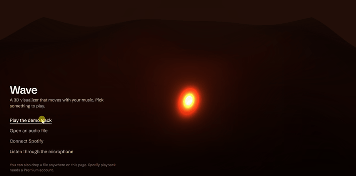

# Wave

Inspired by the Playstation 3 audio visualizer I built a real-time 3D audio visualizer that runs in the browser. A glossy, rippling surface reacts to the music: bass lifts canyon walls along the sides, mids and treble add ripples, and beats flash the lighting. The camera eases between three scenes every 15 seconds.

Live: https://wavevisualizer.com



## Ways to play

- Play the demo track. It's generated in the browser, so you don't need a file.
- Open or drag in your own audio file.
- Connect Spotify. You need Premium, and for now your account has to be added to the app because it's still in Spotify's development mode. Spotify doesn't give access to the raw audio, so the visuals listen to the tab's sound on desktop or the mic on phones.
- Use the microphone.

You can also paste in lyrics. Plain text just shows on screen, and `.lrc` lyrics with timestamps highlight along with the song.

## How it works

Every source goes into one Web Audio `AnalyserNode`. Each frame I split the frequencies into bass, mids and treble and smooth them out. A beat is when the bass jumps 35% above its average. Those values move the vertices of a 120×120 Three.js plane, and the bloom gets stronger with the bass.

Spotify login uses OAuth with PKCE, so there's no client secret in the code.

## Running it

```bash
python3 -m http.server 8000
npm test
```

No build step, just ES modules. It's hosted on Cloudflare Workers.

## What I'd improve

- Move the wave math into a shader so the mesh can be a lot denser
- Get the Spotify app out of development mode so anyone can sign in
